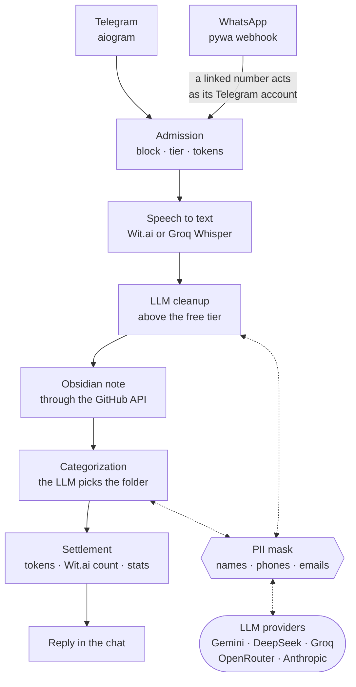

# Evlampiy Notes Bot

[](https://github.com/yastcher/evlampiy/actions/workflows/ci.yml)
[](https://github.com/yastcher/evlampiy/actions/workflows/ci.yml)
[](https://www.python.org/downloads/)
[](LICENSE)

English | [Русский](docs/README.ru.md) | [Español](docs/README.es.md) | [Deutsch](docs/README.de.md)

Voice-to-text bot for Telegram and WhatsApp in four languages: it transcribes a voice message,
cleans the text up with an LLM and files it as a note in your Obsidian vault on GitHub, in a folder
picked by topic.

**Try it:** https://t.me/evlampiy_notes_bot

## How a voice message travels



## Features

### Core
- **Voice transcription** — Convert voice messages to text instantly
- **Multi-platform** — Telegram and WhatsApp support
- **Multi-language** — English, German, Russian, Spanish
- **Per-chat settings** — Individual language and trigger preferences
- **AI text cleanup** — Optional LLM-powered cleanup of transcriptions (removes filler words, fixes punctuation), above the free tier. When `/settings` cleanup is OFF, the reply stays raw but the Obsidian note is still cleaned.

### Transcription Providers
- **Wit.ai** — Default provider with monthly limit tracking
- **Groq Whisper** — Fallback when Wit.ai limit reached; paid users can select manually via `/settings`

### Monetization
- **Token system** — 10 free tokens/month + purchasable packages (1 token = 20 sec audio)
- **Telegram Stars** — Native payment integration with 4 package tiers
- **User tiers** — Free, Paid, VIP (admins too) and Tester; a blocked user is refused

### Obsidian Integration
- **GitHub sync** — Auto-save transcriptions to your vault via GitHub API
- **OAuth Device Flow** — Secure authentication without exposing tokens
- **Repository choice** — Pick an existing GitHub repo or create a new one (any name) when connecting
- **Auto-categorization** — AI-powered note classification (DeepSeek, Groq, Gemini, OpenRouter, Anthropic)
- **Dual-save** — Notes contain cleaned text; raw transcription preserved in an HTML comment for reference
- **vocabulary.json** — Auto-built per-category keyword list that steers the categorization of new notes
- **Cleanup context** — Recent transcriptions from the same chat are passed to the cleanup LLM for better accuracy

### Account Linking
- **Telegram ↔ WhatsApp** — A WhatsApp number linked with a one-time code is your Telegram account: the same tokens, settings and vault
- **Rate limiting** — Protection against brute-force attacks

### Administration
- **Admin panel** — `/admin` hub with inline buttons in Telegram
- **User management** — Add/remove VIP and tester users, block/unblock users, top up tokens via Telegram commands
- **Usage stats** — Monthly transcriptions, revenue, costs
- **Health monitoring** — Admin alerts on Wit.ai usage, the first payment and revenue milestones

## Engineering

- **Boundaries held by tests** — the Telegram and WhatsApp adapters never import each other, and the use cases in `services/` import no aiogram, pywa or FastAPI: `tests/test_architecture.py` (pytestarch) fails otherwise.
- **A real database in tests** — MongoDB 8.0.3, the image production runs, in a testcontainers container; mocks sit only at external APIs, and tests never see the developer's keys.
- **One gate, CI's twin** — `scripts/gate.sh` runs what CI runs, in CI's order: pip-audit over every pin, ruff, ty, Semgrep, the tests with a coverage floor that only rises, shellcheck; a test fails when the two drift apart.
- **Pre-release QA** — `scripts/pre_release_qa.sh` adds a CRAP limit, a smoke of the release image's stack and mutation testing (mutmut) whose survivors only go down; `scripts/release.sh` tags no tree it did not pass.
- **A tag is the release** — CI checks the tag against the tree, builds the image and scans it with Trivy, deploys it with a database dump, a minute of watching and an automatic rollback, then publishes a GitHub Release ([the pipeline](docs/DEPLOY.md#server-deploy-cicd)).
- **Personal data stays out of prompts** — names, phones and emails become tokens before any LLM request and come back in the answer ([ADR-002](docs/adr/ADR-002-pii-is-masked-where-each-llm-client-hands-a-request-to-providers.md)).
- **Decisions on record** — [docs/adr/](docs/adr/README.md) keeps the decisions in force with their reasons.

## Requirements

- Python 3.14+
- MongoDB
- FFmpeg (for audio processing)
- Docker (the tests start MongoDB in a container)
- [Wit.ai](https://wit.ai/) API tokens
- Telegram Bot token from [@BotFather](https://t.me/BotFather)
- (Optional) WhatsApp Business API credentials
- (Optional) GitHub OAuth App client ID (for Obsidian integration)
- (Optional) [Groq](https://groq.com/) API key (for Whisper fallback)
- (Optional) AI provider API key — [DeepSeek](https://deepseek.com/), [Groq](https://groq.com/), [Google Gemini](https://ai.google.dev/), [OpenRouter](https://openrouter.ai/), or [Anthropic](https://anthropic.com/) (for auto-categorization and GPT commands)

## Quick Start

```bash
# Clone
git clone https://github.com/yastcher/evlampiy.git
cd evlampiy

# Install dependencies
pip install uv
uv sync

# Configure
cp .env.example .env
# Edit .env with your tokens

# Run
uv run python -m evlampiy.main
```

## Configuration

`.env.example` lists every setting with a comment. The minimum:

```env
TELEGRAM_BOT_TOKEN=your_bot_token        # from @BotFather
MONGO_URI=mongodb://localhost:27017/
WIT_EN_TOKEN=your_wit_token              # one per language spoken: WIT_RU_TOKEN, WIT_ES_TOKEN, WIT_DE_TOKEN
```

The rest switch features on:

- WhatsApp — `WHATSAPP_*`, see [WhatsApp Setup](docs/WHATSAPP_SETUP.md)
- the Obsidian vault — `GITHUB_CLIENT_ID`, see [GitHub OAuth App](docs/GITHUB_TOKEN_SETUP.md)
- the Whisper fallback — `GROQ_API_KEY`
- LLM cleanup, sorting and the GPT chat — `CATEGORIZATION_PROVIDER` and `GPT_PROVIDER` (Gemini by default) with that provider's key; when it fails, the chain tries deepseek → openrouter → gemini → groq; a host that cannot reach them goes through `LLM_API_BASE` ([DEPLOY.md](docs/DEPLOY.md#llm-providers-blocked-on-the-host))
- admins — `ADMIN_USER_IDS`; VIP users and testers are managed with `/admin` in Telegram

## Bot Commands

| Command     | Description                              |
|-------------|------------------------------------------|
| `/start`    | Show help and current settings           |
| `/settings` | Language, GPT command & provider settings |
| `/obsidian` | Notes sync to GitHub (Obsidian vault)    |
| `/account`  | Balance, tokens & WhatsApp linking       |

## Development

```bash
# Install dev dependencies
uv sync --group dev

# Run tests
uv run pytest

# Run linter
uv run ruff check

# Run type checker
uv run ty check evlampiy tests

# Everything CI checks, in CI's order (tests include the coverage floor)
scripts/gate.sh
```

## Documentation

| Document | Description |
|----------|-------------|
| [Architecture](docs/ARCHITECTURE.md) | Directory structure, data flow, engineering decisions, rate limits |
| [Glossary](docs/GLOSSARY.md) | The project's own words: chats, tiers, tokens, the mask, the vault |
| [Deployment](docs/DEPLOY.md) | Docker, the release pipeline, database dumps and rollback, health checks, logs |
| [Decisions](docs/adr/README.md) | Architecture decisions in force, each with its reason |
| [Admin Guide](docs/ADMIN.md) | Admin commands, user roles, alerts, monitoring |
| [WhatsApp Setup](docs/WHATSAPP_SETUP.md) | WhatsApp Business API configuration |
| [Account Linking](docs/WHATSAPP_LINKING.md) | Telegram ↔ WhatsApp account linking |
| [GitHub OAuth App](docs/GITHUB_TOKEN_SETUP.md) | The OAuth App behind `GITHUB_CLIENT_ID`, for the Obsidian connection |

## License

Proprietary. All rights reserved. See [LICENSE](LICENSE).
