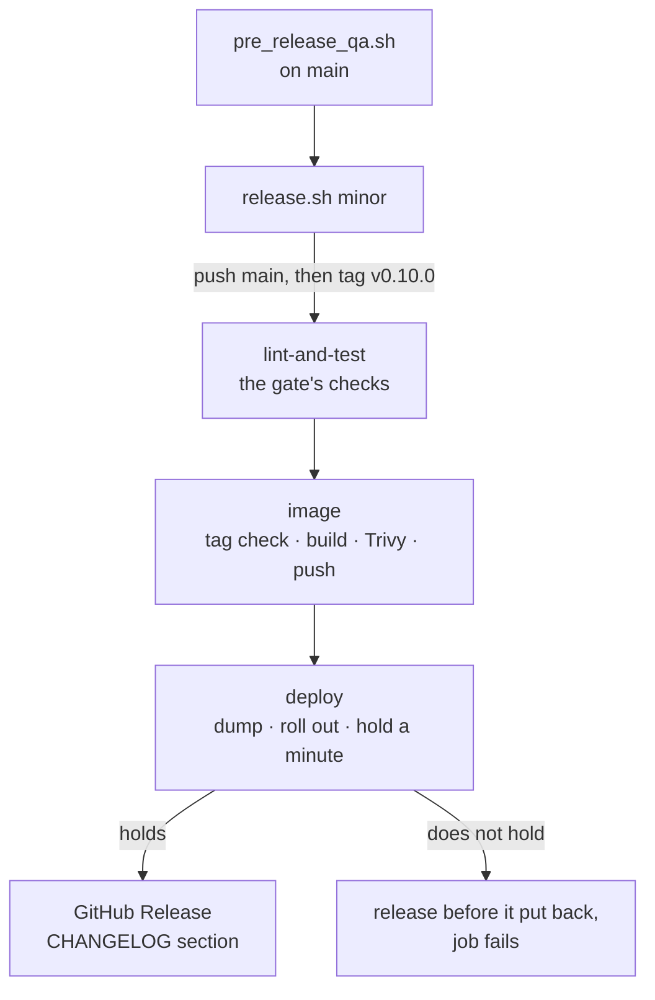
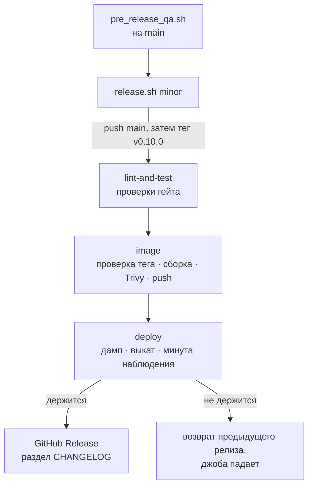

# Deployment Guide

[Русский](#развёртывание) | [English](#english)

---

## English

### Installation

```bash
git clone https://github.com/yastcher/evlampiy.git
cd evlampiy
pip install uv
uv sync
```

### Configuration

Create `.env` file:

```env
# Required: Telegram
TELEGRAM_BOT_TOKEN=your_bot_token
MONGO_URI=mongodb://localhost:27017/

# Required: Wit.ai (voice recognition)
WIT_RU_TOKEN=your_wit_ru_token
WIT_EN_TOKEN=your_wit_en_token
WIT_ES_TOKEN=your_wit_es_token
WIT_DE_TOKEN=your_wit_de_token

# Optional: GPT integration
GPT_TOKEN=your_openai_token
GPT_MODEL=gpt-4o-mini

# Optional: WhatsApp integration (see docs/WHATSAPP_SETUP.md)
WHATSAPP_TOKEN=your_whatsapp_token
WHATSAPP_PHONE_ID=your_phone_id
WHATSAPP_VERIFY_TOKEN=your_verify_token
WHATSAPP_APP_ID=your_app_id
# Required for WhatsApp: without it the webhook stays off
WHATSAPP_APP_SECRET=your_app_secret

# Optional: GitHub OAuth (for Obsidian integration)
GITHUB_CLIENT_ID=your_github_oauth_app_client_id

# Optional: Monetization
GROQ_API_KEY=your_groq_api_key
VIP_USER_IDS=123456,789012
ADMIN_USER_IDS=123456789
FREE_MONTHLY_TOKENS=10
WIT_FREE_MONTHLY_LIMIT=500

# Optional: AI provider for categorization and GPT (deepseek / groq / gemini / openrouter / anthropic)
CATEGORIZATION_PROVIDER=deepseek
GPT_PROVIDER=deepseek
DEEPSEEK_API_KEY=your_deepseek_api_key
GEMINI_API_KEY=your_gemini_api_key
```

### Local Run

```bash
uv run python -m evlampiy.main
```

### Docker

#### Build and Run

```bash
docker build -t evlampiy_notes:latest .
docker compose up -d
```

#### Docker Compose

The `docker-compose.yml` includes:
- MongoDB database
- Bot service with auto-restart

The bot's HTTP server (`/health` and the WhatsApp webhook) listens on port 8000 of the host's
loopback only: the internet reaches the webhook through a TLS proxy on the same host.

#### Telegram blocked on the host

If `api.telegram.org` is unreachable from the host (e.g. a Russian VPS), deploy the Cloudflare
Worker in `cloudflare/telegram-proxy/` and set `TELEGRAM_API_BASE` to its URL. Empty = official
endpoint.

#### LLM providers blocked on the host

If the LLM provider APIs (Groq / OpenRouter / Gemini / Anthropic / OpenAI) are geo-blocked from the
host, deploy the Cloudflare Worker in `cloudflare/llm-proxy/` and set `LLM_API_BASE` to its URL.
Empty = providers are called directly. DeepSeek and Qwen are reached directly and not proxied.

### Server deploy (CI/CD)

A release is a `vX.Y.Z` tag, and `.github/workflows/ci.yml` ships it:



1. On `main`, `scripts/pre_release_qa.sh` runs the gate, the CRAP limit, a smoke of the release
   image's stack and mutation testing, and stamps the tree it passed.
2. `scripts/release.sh patch|minor|major` names the `[Unreleased]` section of CHANGELOG.md, commits,
   pushes `main`, then the tag. It tags no tree the QA run did not pass; `SKIP_PRERELEASE_QA=1` is
   for a hotfix that cannot wait.
3. On the tag, after the checks, the `image` job checks the tag against the tree
   (`scripts/release_from_tag.py`), builds the image, scans its OS packages with Trivy (a fixable
   HIGH or CRITICAL fails the release; the Python pins are `scripts/audit_deps.py`'s, in the
   checks) and pushes `:vX.Y.Z` and `:latest` to **GHCR** (`ghcr.io/yastcher/evlampiy_notes`).
   A pull request builds and scans the image too, without pushing it.
4. The `deploy` job copies `docker-compose.yml` and `deploy/*.sh` to the server over SSH and runs
   `deploy/deploy.sh`: a `mongodump`, the release pinned in `.env` (`EVLAMPIY_IMAGE`, `IMAGE_TAG`),
   pull, start. The release has to answer `/health`, hold a minute with nothing restarting and be
   the image that runs; otherwise the release before it is put back and the job fails. Two tags
   never deploy at once.
5. After a deploy that held, the `release` job publishes a GitHub Release with the tag's CHANGELOG
   section.

The registry needs no extra secret: push and pull use the run's own `GITHUB_TOKEN`.

#### GitHub secrets

| Name | Description |
|---|---|
| `SSH_PRIVATE_KEY` | base64 ssh key (`cat ~/.ssh/id_rsa \| base64 -w0`); the user must be in the `docker` group |
| `SSH_KNOWN_HOSTS` | the server's host key, the only one the deploy trusts: `ssh-keygen -F <SERVER_IP>` on a machine that already connects to it, without the `#` line |
| `SERVER_IP` | server IP / hostname |
| `SERVER_USER` | ssh user — unprivileged, not `root` (e.g. `yast`) |
| `DEPLOY_DIR` | optional, path relative to `~`; defaults to `evlampiy` |

#### Server prep (once)

```bash
# Docker + compose plugin, then let the deploy user talk to the daemon
curl -fsSL https://get.docker.com | sh
sudo usermod -aG docker "$USER" && newgrp docker

mkdir -p ~/evlampiy && cd ~/evlampiy
# Put the real .env here (see Configuration above) — CI does not deploy it.
```

The deploy dir holds `mongo_data/`, the bind mount backing MongoDB — **it is the database**. Every
release dumps it into `backups/` first and keeps the newest ten. Dump it the same way before moving
or deleting the directory (`docker compose exec -T mongodb mongodump --archive --gzip > dump.gz`);
restore a dump with `docker compose exec -T mongodb mongorestore --archive --gzip --drop < backups/<file>`.

#### Rollback

A release that does not hold is rolled back by the deploy itself. To return by hand to a release
that ran before:

```bash
cd ~/evlampiy
bash deploy/rollback.sh v0.9.7
```

It runs that release's own compose file, kept as `docker-compose.v0.9.7.yml` when the next release
arrived, and its image. The database stays as it is: the dump taken before each release is in
`backups/`.

### WhatsApp Webhook Setup

If using WhatsApp integration:

1. **HTTPS**: WhatsApp requires HTTPS. Run a reverse proxy (nginx, Caddy) with SSL on the bot's
   host and open 443, not 8000: the bot listens on the host's loopback only
2. **Webhook URL**: Configure in Meta Developer Console as `https://your-domain.com/`

Example nginx configuration:

```nginx
server {
    listen 443 ssl;
    server_name your-domain.com;

    ssl_certificate /path/to/cert.pem;
    ssl_certificate_key /path/to/key.pem;

    location / {
        proxy_pass http://localhost:8000;
        proxy_set_header Host $host;
        proxy_set_header X-Real-IP $remote_addr;
    }
}
```

### Health Check

The bot always exposes a liveness endpoint (served even when WhatsApp is not configured):

```bash
curl http://localhost:8000/health
# {"status": "ok", "whatsapp": "on"}   (whatsapp: on | off | no app secret)
```

`docker-compose.yml` wires a container healthcheck to it (status shows in `docker ps`). Plain
Compose reports health but does not restart unhealthy containers — pair it with an orchestrator
or an autoheal sidecar if you want automatic restart on failure.

### Development

```bash
# Install dev dependencies
uv sync --group dev

# Run linter
uv run ruff check

# Run tests
uv run pytest

# Everything CI checks, in CI's order (tests include the coverage floor)
scripts/gate.sh
```

### Logs

```bash
# Docker logs
docker compose logs -f evlampiy_bot

# Filter by level
docker compose logs evlampiy_bot 2>&1 | grep ERROR
```

---

## Развёртывание

### Установка

```bash
git clone https://github.com/yastcher/evlampiy.git
cd evlampiy
pip install uv
uv sync
```

### Конфигурация

Создайте файл `.env`:

```env
# Обязательно: Telegram
TELEGRAM_BOT_TOKEN=ваш_токен_бота
MONGO_URI=mongodb://localhost:27017/

# Обязательно: Wit.ai (распознавание голоса)
WIT_RU_TOKEN=ваш_wit_ru_токен
WIT_EN_TOKEN=ваш_wit_en_токен
WIT_ES_TOKEN=ваш_wit_es_токен
WIT_DE_TOKEN=ваш_wit_de_токен

# Опционально: интеграция с GPT
GPT_TOKEN=ваш_openai_токен
GPT_MODEL=gpt-4o-mini

# Опционально: интеграция с WhatsApp (см. docs/WHATSAPP_SETUP.md)
WHATSAPP_TOKEN=ваш_whatsapp_токен
WHATSAPP_PHONE_ID=ваш_phone_id
WHATSAPP_VERIFY_TOKEN=ваш_verify_токен
WHATSAPP_APP_ID=ваш_app_id
# Обязателен для WhatsApp: без него вебхук не включается
WHATSAPP_APP_SECRET=ваш_app_secret

# Опционально: GitHub OAuth (для интеграции с Obsidian)
GITHUB_CLIENT_ID=ваш_github_oauth_app_client_id

# Опционально: Монетизация
GROQ_API_KEY=ваш_groq_api_ключ
VIP_USER_IDS=123456,789012
ADMIN_USER_IDS=123456789
FREE_MONTHLY_TOKENS=10
WIT_FREE_MONTHLY_LIMIT=500

# Опционально: AI-провайдер для категоризации и GPT (deepseek / groq / gemini / openrouter / anthropic)
CATEGORIZATION_PROVIDER=deepseek
GPT_PROVIDER=deepseek
DEEPSEEK_API_KEY=ваш_deepseek_api_ключ
GEMINI_API_KEY=ваш_gemini_api_ключ
```

### Локальный запуск

```bash
uv run python -m evlampiy.main
```

### Docker

#### Сборка и запуск

```bash
docker build -t evlampiy_notes:latest .
docker compose up -d
```

#### Docker Compose

`docker-compose.yml` включает:
- База данных MongoDB
- Сервис бота с авто-перезапуском

HTTP-сервер бота (`/health` и вебхук WhatsApp) слушает порт 8000 только на loopback хоста:
из интернета вебхук доходит через TLS-прокси на том же хосте.

#### Telegram заблокирован на хосте

Если `api.telegram.org` недоступен с хоста (например, российский VPS), задеплойте Cloudflare
Worker из `cloudflare/telegram-proxy/` и укажите `TELEGRAM_API_BASE` с его URL. Пусто = официальный
endpoint.

#### LLM-провайдеры заблокированы на хосте

Если API LLM-провайдеров (Groq / OpenRouter / Gemini / Anthropic / OpenAI) гео-блокнуты с хоста,
задеплойте Cloudflare Worker из `cloudflare/llm-proxy/` и укажите `LLM_API_BASE` с его URL. Пусто =
прямые вызовы. DeepSeek и Qwen ходят напрямую и не проксируются.

### Деплой на сервер (CI/CD)

Релиз — это тег `vX.Y.Z`, его выкатывает `.github/workflows/ci.yml`:



1. На `main` `scripts/pre_release_qa.sh` прогоняет гейт, лимит CRAP, смоук стека из релизного
   образа и мутационное тестирование и штампует дерево, которое прошло.
2. `scripts/release.sh patch|minor|major` даёт номер разделу `[Unreleased]` в CHANGELOG.md,
   коммитит, пушит `main`, затем тег. Дерево без прошедшего QA он не тегирует;
   `SKIP_PRERELEASE_QA=1` — для хотфикса, который не может ждать.
3. На теге после проверок джоба `image` сверяет тег с деревом (`scripts/release_from_tag.py`),
   собирает образ, сканирует его системные пакеты Trivy (исправимая HIGH или CRITICAL валит
   релиз; Python-зависимости проверяет `scripts/audit_deps.py` в проверках) и пушит `:vX.Y.Z` и
   `:latest` в **GHCR** (`ghcr.io/yastcher/evlampiy_notes`). Pull request тоже собирает и
   сканирует образ, но не пушит.
4. Джоба `deploy` копирует по SSH на сервер `docker-compose.yml` и `deploy/*.sh` и запускает
   `deploy/deploy.sh`: `mongodump`, релиз закрепляется в `.env` (`EVLAMPIY_IMAGE`, `IMAGE_TAG`),
   pull, старт. Релиз должен ответить на `/health`, продержаться минуту без перезапусков и
   оказаться тем образом, который работает; иначе возвращается предыдущий релиз и джоба падает.
   Два тега одновременно не выкатываются.
5. Если выкат удержался, джоба `release` публикует GitHub Release с разделом CHANGELOG этого тега.

Реестр не требует дополнительных секретов: push и pull идут по `GITHUB_TOKEN` самого прогона.

#### GitHub secrets

| Имя | Описание |
|---|---|
| `SSH_PRIVATE_KEY` | base64 ssh-ключ (`cat ~/.ssh/id_rsa \| base64 -w0`); пользователь должен быть в группе `docker` |
| `SSH_KNOWN_HOSTS` | ключ хоста сервера — деплой доверяет только ему: `ssh-keygen -F <SERVER_IP>` на машине, которая уже ходит на сервер, без строки с `#` |
| `SERVER_IP` | IP / hostname сервера |
| `SERVER_USER` | пользователь для ssh — непривилегированный, не `root` (например `yast`) |
| `DEPLOY_DIR` | опционально, путь относительно `~`; по умолчанию `evlampiy` |

#### Подготовка сервера (один раз)

```bash
# Docker + compose-plugin, затем доступ деплой-юзера к демону
curl -fsSL https://get.docker.com | sh
sudo usermod -aG docker "$USER" && newgrp docker

mkdir -p ~/evlampiy && cd ~/evlampiy
# Положите сюда настоящий .env (см. «Конфигурация» выше) — CI его не деплоит.
```

В деплой-директории лежит `mongo_data/` — bind-mount MongoDB, **то есть сама база**. Каждый релиз
сначала снимает её дамп в `backups/` и хранит десять последних. Перед переносом или удалением
директории снимите дамп так же (`docker compose exec -T mongodb mongodump --archive --gzip > dump.gz`);
восстановление: `docker compose exec -T mongodb mongorestore --archive --gzip --drop < backups/<файл>`.

#### Откат

Релиз, который не удержался, деплой откатывает сам. Вернуться вручную к релизу, который работал
раньше:

```bash
cd ~/evlampiy
bash deploy/rollback.sh v0.9.7
```

Он запускает собственный compose-файл того релиза (сохранён как `docker-compose.v0.9.7.yml`, когда
пришёл следующий) и его образ. База остаётся как есть: дамп перед каждым релизом лежит в `backups/`.

### Настройка Webhook для WhatsApp

При использовании WhatsApp:

1. **HTTPS**: WhatsApp требует HTTPS. Поднимите reverse proxy (nginx, Caddy) с SSL на хосте бота
   и откройте 443, а не 8000: бот слушает только loopback хоста
2. **URL Webhook**: Настройте в Meta Developer Console как `https://ваш-домен.com/`

Пример конфигурации nginx:

```nginx
server {
    listen 443 ssl;
    server_name ваш-домен.com;

    ssl_certificate /path/to/cert.pem;
    ssl_certificate_key /path/to/key.pem;

    location / {
        proxy_pass http://localhost:8000;
        proxy_set_header Host $host;
        proxy_set_header X-Real-IP $remote_addr;
    }
}
```

### Проверка работоспособности

Бот предоставляет endpoint для проверки:

```bash
curl http://localhost:8000/health
# {"status": "ok", "whatsapp": "on"}   (whatsapp: on | off | no app secret)
```

### Разработка

```bash
# Установка dev-зависимостей
uv sync --group dev

# Запуск линтера
uv run ruff check

# Запуск тестов
uv run pytest

# Всё, что проверяет CI, в том же порядке (тесты — с порогом покрытия)
scripts/gate.sh
```

### Логи

```bash
# Логи Docker
docker compose logs -f evlampiy_bot

# Фильтр по уровню
docker compose logs evlampiy_bot 2>&1 | grep ERROR
```
