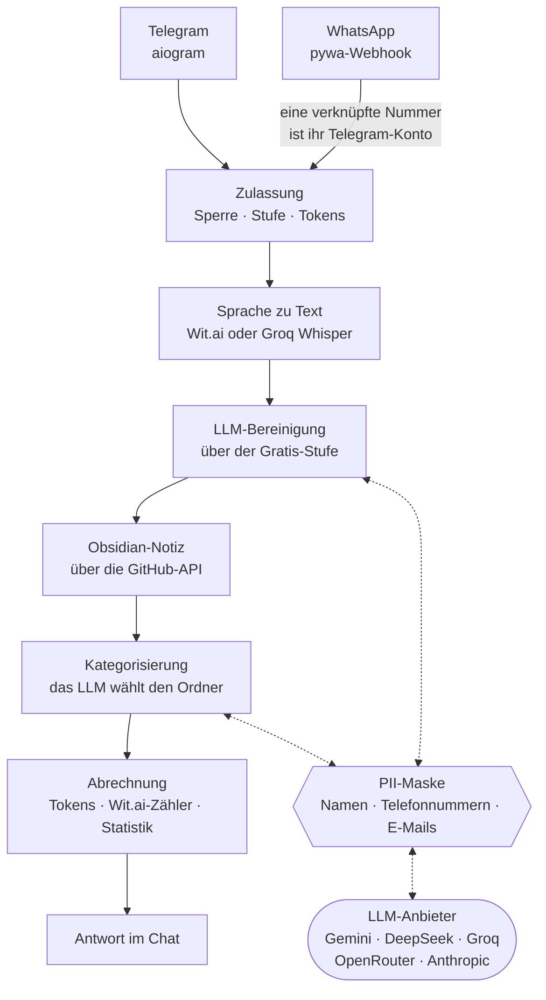

# Evlampiy Notes Bot

[](https://github.com/yastcher/evlampiy/actions/workflows/ci.yml)
[](https://github.com/yastcher/evlampiy/actions/workflows/ci.yml)
[](https://www.python.org/downloads/)
[](../LICENSE)

[English](../README.md) | [Русский](README.ru.md) | [Español](README.es.md) | Deutsch

Sprache-zu-Text Bot für Telegram und WhatsApp in vier Sprachen: Er transkribiert eine
Sprachnachricht, bereinigt den Text mit einem LLM und legt ihn als Notiz in deinem Obsidian-Vault
auf GitHub ab, in einem Ordner nach Thema.

**Ausprobieren:** https://t.me/evlampiy_notes_bot

## Der Weg einer Sprachnachricht



## Funktionen

### Kern
- **Sprachtranskription** — Sofortige Umwandlung von Sprachnachrichten in Text
- **Multiplattform** — Telegram und WhatsApp
- **Mehrsprachig** — Englisch, Deutsch, Russisch, Spanisch
- **Chat-Einstellungen** — Individuelle Sprache und Trigger für jeden Chat
- **KI-Textbereinigung** — Optionale LLM-gestützte Bereinigung von Transkriptionen (entfernt Füllwörter, korrigiert Zeichensetzung) oberhalb der kostenlosen Stufe. Wenn die Bereinigung deaktiviert ist, bleibt die Telegram-Antwort roh, die Obsidian-Notiz wird jedoch bereinigt.

### Transkriptionsanbieter
- **Wit.ai** — Standardanbieter mit monatlicher Limitüberwachung
- **Groq Whisper** — Fallback bei Erreichen des Wit.ai-Limits; zahlende Nutzer können manuell über `/settings` wählen

### Monetarisierung
- **Token-System** — 10 kostenlose Tokens/Monat + kaufbare Pakete (1 Token = 20 Sek. Audio)
- **Telegram Stars** — Native Zahlungsintegration mit 4 Paketstufen
- **Benutzerstufen** — Free, Paid, VIP (auch Admins) und Tester; einem gesperrten Benutzer verweigert der Bot den Dienst

### Obsidian-Integration
- **GitHub-Synchronisierung** — Automatisches Speichern von Transkriptionen in Ihrem Vault über GitHub API
- **OAuth Device Flow** — Sichere Authentifizierung ohne Token-Offenlegung
- **Repository-Auswahl** — Beim Verbinden ein vorhandenes GitHub-Repository wählen oder ein neues erstellen (beliebiger Name)
- **Auto-Kategorisierung** — KI-gestützte Notizklassifizierung (DeepSeek, Groq, Gemini, OpenRouter, Anthropic)
- **Duales Speichern** — Notizen enthalten bereinigten Text; die rohe Transkription wird in einem HTML-Kommentar aufbewahrt
- **vocabulary.json** — Automatisch aufgebaute Stichwortliste je Kategorie; lenkt die Kategorisierung neuer Notizen
- **Bereinigungskontext** — Neueste Transkriptionen aus demselben Chat werden dem LLM zur präziseren Bereinigung übergeben

### Kontoverknüpfung
- **Telegram ↔ WhatsApp** — Eine per Einmalcode verknüpfte WhatsApp-Nummer ist dein Telegram-Konto: dieselben Tokens, Einstellungen und derselbe Vault
- **Rate Limiting** — Schutz gegen Brute-Force-Angriffe

### Administration
- **Admin-Panel** — `/admin` Hub mit Inline-Buttons in Telegram
- **Benutzerverwaltung** — VIP- und Tester-Benutzer hinzufügen/entfernen, sperren/entsperren, Tokens aufladen über Telegram
- **Nutzungsstatistiken** — Monatliche Transkriptionen, Einnahmen, Kosten
- **Gesundheitsüberwachung** — Admin-Alarme zu Wit.ai-Nutzung, erster Zahlung und Umsatzmeilensteinen

## Engineering

- **Grenzen, die Tests halten** — die Telegram- und WhatsApp-Adapter importieren einander nie, und die Use Cases in `services/` importieren weder aiogram noch pywa noch FastAPI: sonst schlägt `tests/test_architecture.py` (pytestarch) fehl.
- **Eine echte Datenbank in den Tests** — MongoDB 8.0.3, das Image der Produktion, in einem testcontainers-Container; Mocks gibt es nur an externen APIs, und die Tests sehen nie die Schlüssel des Entwicklers.
- **Ein Gate, der Zwilling von CI** — `scripts/gate.sh` führt aus, was CI ausführt, in derselben Reihenfolge: pip-audit über jede gepinnte Version, ruff, ty, Semgrep, die Tests mit einer Coverage-Schwelle, die nur steigt, shellcheck; ein Test schlägt fehl, wenn beide auseinanderlaufen.
- **QA vor dem Release** — `scripts/pre_release_qa.sh` ergänzt ein CRAP-Limit, einen Smoke-Test des Stacks aus dem Release-Image und Mutationstests (mutmut), deren Überlebende nur weniger werden; `scripts/release.sh` taggt keinen Baum, der sie nicht bestanden hat.
- **Ein Tag ist das Release** — CI prüft den Tag gegen den Baum, baut das Image und scannt es mit Trivy, rollt es mit einem Datenbank-Dump, einer Minute Beobachtung und automatischem Rollback aus und veröffentlicht dann ein GitHub Release ([die Pipeline](DEPLOY.md#server-deploy-cicd)).
- **Personenbezogene Daten bleiben aus den Prompts** — Namen, Telefonnummern und E-Mails werden vor jeder LLM-Anfrage zu Tokens und kommen in der Antwort zurück ([ADR-002](adr/ADR-002-pii-is-masked-where-each-llm-client-hands-a-request-to-providers.md)).
- **Entscheidungen festgehalten** — [docs/adr/](adr/README.md) hält die geltenden Entscheidungen mit ihren Gründen fest.

## Voraussetzungen

- Python 3.14+
- MongoDB
- FFmpeg (für Audioverarbeitung)
- Docker (die Tests starten MongoDB in einem Container)
- [Wit.ai](https://wit.ai/) API-Tokens
- Telegram Bot-Token von [@BotFather](https://t.me/BotFather)
- (Optional) WhatsApp Business API-Zugangsdaten
- (Optional) GitHub OAuth App Client-ID (für Obsidian-Integration)
- (Optional) [Groq](https://groq.com/) API-Schlüssel (für Whisper-Fallback-Transkription)
- (Optional) API-Schlüssel eines KI-Anbieters — [DeepSeek](https://deepseek.com/), [Groq](https://groq.com/), [Google Gemini](https://ai.google.dev/), [OpenRouter](https://openrouter.ai/) oder [Anthropic](https://anthropic.com/) (für Auto-Kategorisierung und GPT-Befehle)

## Schnellstart

```bash
# Klonen
git clone https://github.com/yastcher/evlampiy.git
cd evlampiy

# Abhängigkeiten installieren
pip install uv
uv sync

# Konfigurieren
cp .env.example .env
# Bearbeite .env mit deinen Tokens

# Starten
uv run python -m evlampiy.main
```

## Konfiguration

`.env.example` listet jede Einstellung mit einem Kommentar. Das Minimum:

```env
TELEGRAM_BOT_TOKEN=dein_bot_token        # von @BotFather
MONGO_URI=mongodb://localhost:27017/
WIT_DE_TOKEN=dein_wit_token              # einer pro gesprochener Sprache: WIT_EN_TOKEN, WIT_RU_TOKEN, WIT_ES_TOKEN
```

Der Rest schaltet Funktionen ein:

- WhatsApp — `WHATSAPP_*`, siehe [WhatsApp-Einrichtung](WHATSAPP_SETUP.md)
- der Obsidian-Vault — `GITHUB_CLIENT_ID`, siehe [GitHub OAuth App](GITHUB_TOKEN_SETUP.md)
- der Whisper-Fallback — `GROQ_API_KEY`
- LLM-Bereinigung, Sortierung und der GPT-Chat — `CATEGORIZATION_PROVIDER` und `GPT_PROVIDER` (standardmäßig Gemini) mit dem Schlüssel dieses Anbieters; fällt er aus, versucht die Kette deepseek → openrouter → gemini → groq; ein Host, der sie nicht erreicht, geht über `LLM_API_BASE` ([DEPLOY.md](DEPLOY.md#llm-providers-blocked-on-the-host))
- Admins — `ADMIN_USER_IDS`; VIP-Nutzer und Tester werden mit `/admin` in Telegram verwaltet

## Bot-Befehle

| Befehl      | Beschreibung                             |
|-------------|------------------------------------------|
| `/start`    | Hilfe und aktuelle Einstellungen         |
| `/settings` | Sprache, GPT-Befehl und Anbieter         |
| `/obsidian` | Notizen-Synchronisierung mit GitHub      |
| `/account`  | Guthaben, Tokens und WhatsApp-Verknüpfung |

## Entwicklung

```bash
# Dev-Abhängigkeiten installieren
uv sync --group dev

# Tests ausführen
uv run pytest

# Linter ausführen
uv run ruff check

# Typprüfung ausführen
uv run ty check evlampiy tests

# Alles, was CI prüft, in derselben Reihenfolge (Tests inklusive Coverage-Schwelle)
scripts/gate.sh
```

## Dokumentation

| Dokument | Beschreibung |
|----------|-------------|
| [Architektur](ARCHITECTURE.md) | Verzeichnisstruktur, Datenfluss, technische Entscheidungen, Limits (English) |
| [Glossar](GLOSSARY.md) | Die Begriffe des Projekts: Chats, Stufen, Tokens, die Maske, der Vault (English) |
| [Deployment](DEPLOY.md) | Docker, die Release-Pipeline, Datenbank-Dumps und Rollback, Health Checks, Logs |
| [Entscheidungen](adr/README.md) | Geltende Architekturentscheidungen, jede mit ihrem Grund (English) |
| [Administration](ADMIN.md) | Admin-Befehle, Rollen, Alarme, Monitoring |
| [WhatsApp-Einrichtung](WHATSAPP_SETUP.md) | WhatsApp Business API Konfiguration |
| [Kontoverknüpfung](WHATSAPP_LINKING.md) | Telegram ↔ WhatsApp Verknüpfung |
| [GitHub OAuth App](GITHUB_TOKEN_SETUP.md) | Die OAuth App hinter `GITHUB_CLIENT_ID` für die Obsidian-Anbindung |

## Lizenz

Proprietär. Alle Rechte vorbehalten. Siehe [LICENSE](../LICENSE).
