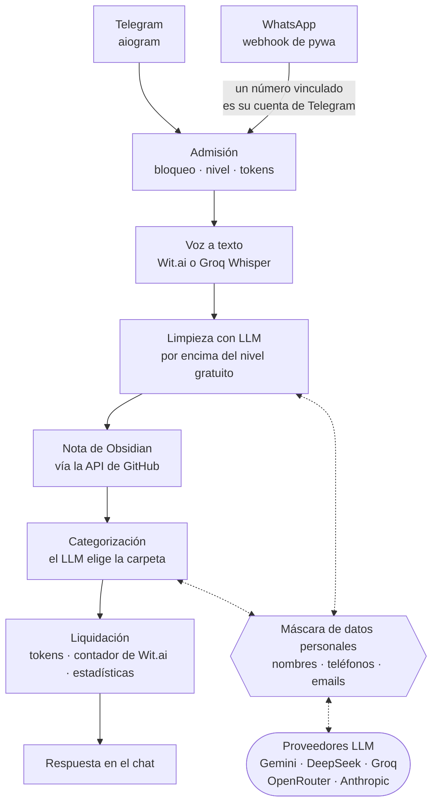

# Evlampiy Notes Bot

[](https://github.com/yastcher/evlampiy/actions/workflows/ci.yml)
[](https://github.com/yastcher/evlampiy/actions/workflows/ci.yml)
[](https://www.python.org/downloads/)
[](../LICENSE)

[English](../README.md) | [Русский](README.ru.md) | Español | [Deutsch](README.de.md)

Bot de voz a texto para Telegram y WhatsApp en cuatro idiomas: transcribe un mensaje de voz,
limpia el texto con un LLM y lo guarda como nota en tu vault de Obsidian en GitHub, en una
carpeta elegida por tema.

**Pruébalo:** https://t.me/evlampiy_notes_bot

## Cómo viaja un mensaje de voz



## Características

### Principal
- **Transcripción de voz** — Conversión instantánea de mensajes de voz a texto
- **Multiplataforma** — Telegram y WhatsApp
- **Multilingüe** — Inglés, alemán, ruso, español
- **Configuración por chat** — Idioma y trigger individual para cada chat
- **Limpieza de texto con IA** — Limpieza opcional de transcripciones mediante LLM (elimina muletillas, corrige puntuación), por encima del nivel gratuito. Si la limpieza está desactivada, la respuesta en Telegram es el texto original, pero la nota en Obsidian se limpia igualmente.

### Proveedores de transcripción
- **Wit.ai** — Proveedor predeterminado con seguimiento del límite mensual
- **Groq Whisper** — Respaldo cuando se alcanza el límite de Wit.ai; usuarios de pago pueden elegir manualmente en `/settings`

### Monetización
- **Sistema de tokens** — 10 tokens gratis/mes + paquetes comprables (1 token = 20 seg de audio)
- **Telegram Stars** — Integración de pagos nativa con 4 niveles de paquetes
- **Niveles de usuario** — Free, Paid, VIP (también los administradores) y Tester; a un usuario bloqueado el bot lo rechaza

### Integración con Obsidian
- **Sincronización GitHub** — Guardado automático de transcripciones en tu vault vía GitHub API
- **OAuth Device Flow** — Autenticación segura sin exponer tokens
- **Elección de repositorio** — Al conectar, elige un repositorio de GitHub existente o crea uno nuevo (con cualquier nombre)
- **Auto-categorización** — Clasificación de notas con IA (DeepSeek, Groq, Gemini, OpenRouter, Anthropic)
- **Guardado dual** — Las notas contienen texto limpio; la transcripción original se preserva en un comentario HTML
- **vocabulary.json** — Lista de palabras clave por categoría, construida automáticamente, que orienta la categorización de las notas nuevas
- **Contexto de limpieza** — Las transcripciones recientes del mismo chat se pasan al LLM para mayor precisión

### Vinculación de cuentas
- **Telegram ↔ WhatsApp** — Un número de WhatsApp vinculado con un código de un solo uso es tu cuenta de Telegram: los mismos tokens, ajustes y bóveda
- **Rate limiting** — Protección contra ataques de fuerza bruta

### Administración
- **Panel de administración** — Hub `/admin` con botones inline en Telegram
- **Gestión de usuarios** — Añadir/eliminar usuarios VIP y testers, bloquear/desbloquear, recargar tokens vía Telegram
- **Estadísticas de uso** — Transcripciones, ingresos, costos mensuales
- **Monitoreo de salud** — Alertas a los administradores sobre el uso de Wit.ai, el primer pago y los hitos de ingresos

## Ingeniería

- **Límites que sostienen los tests** — los adaptadores de Telegram y WhatsApp nunca se importan entre sí, y los casos de uso en `services/` no importan aiogram, pywa ni FastAPI: si no, falla `tests/test_architecture.py` (pytestarch).
- **Una base de datos real en los tests** — MongoDB 8.0.3, la imagen que corre en producción, en un contenedor de testcontainers; los mocks están solo en las APIs externas, y los tests nunca ven las claves del desarrollador.
- **Un gate, gemelo de CI** — `scripts/gate.sh` ejecuta lo mismo que CI, en el mismo orden: pip-audit sobre cada versión fijada, ruff, ty, Semgrep, los tests con un umbral de cobertura que solo sube, shellcheck; un test falla si los dos se separan.
- **QA antes del release** — `scripts/pre_release_qa.sh` añade un límite de CRAP, un smoke del stack con la imagen del release y mutation testing (mutmut) cuyos supervivientes solo bajan; `scripts/release.sh` no etiqueta un árbol que no lo haya pasado.
- **Un tag es el release** — CI comprueba el tag contra el árbol, construye la imagen y la escanea con Trivy, la despliega con un dump de la base de datos, un minuto de observación y rollback automático, y luego publica un GitHub Release ([el pipeline](DEPLOY.md#server-deploy-cicd)).
- **Los datos personales no llegan a los prompts** — nombres, teléfonos y emails se convierten en tokens antes de cualquier petición a un LLM y vuelven en la respuesta ([ADR-002](adr/ADR-002-pii-is-masked-where-each-llm-client-hands-a-request-to-providers.md)).
- **Decisiones registradas** — [docs/adr/](adr/README.md) guarda las decisiones vigentes con sus razones.

## Requisitos

- Python 3.14+
- MongoDB
- FFmpeg (para procesamiento de audio)
- Docker (los tests levantan MongoDB en un contenedor)
- Tokens API de [Wit.ai](https://wit.ai/)
- Token de bot Telegram de [@BotFather](https://t.me/BotFather)
- (Opcional) Credenciales de WhatsApp Business API
- (Opcional) GitHub OAuth App client ID (para integración con Obsidian)
- (Opcional) [Groq](https://groq.com/) API key (para transcripción de respaldo Whisper)
- (Opcional) API key de proveedor IA — [DeepSeek](https://deepseek.com/), [Groq](https://groq.com/), [Google Gemini](https://ai.google.dev/), [OpenRouter](https://openrouter.ai/) o [Anthropic](https://anthropic.com/) (para auto-categorización y comandos GPT)

## Inicio Rápido

```bash
# Clonar
git clone https://github.com/yastcher/evlampiy.git
cd evlampiy

# Instalar dependencias
pip install uv
uv sync

# Configurar
cp .env.example .env
# Edita .env con tus tokens

# Ejecutar
uv run python -m evlampiy.main
```

## Configuración

`.env.example` lista cada ajuste con un comentario. Lo mínimo:

```env
TELEGRAM_BOT_TOKEN=tu_token_de_bot       # de @BotFather
MONGO_URI=mongodb://localhost:27017/
WIT_ES_TOKEN=tu_token_de_wit             # uno por idioma hablado: WIT_EN_TOKEN, WIT_RU_TOKEN, WIT_DE_TOKEN
```

El resto activa funciones:

- WhatsApp — `WHATSAPP_*`, ver [Configuración de WhatsApp](WHATSAPP_SETUP.md)
- el vault de Obsidian — `GITHUB_CLIENT_ID`, ver [GitHub OAuth App](GITHUB_TOKEN_SETUP.md)
- el respaldo de Whisper — `GROQ_API_KEY`
- limpieza con LLM, clasificación y el chat GPT — `CATEGORIZATION_PROVIDER` y `GPT_PROVIDER` (Gemini por defecto) con la clave de ese proveedor; si falla, la cadena prueba deepseek → openrouter → gemini → groq; un host que no los alcanza pasa por `LLM_API_BASE` ([DEPLOY.md](DEPLOY.md#llm-providers-blocked-on-the-host))
- administradores — `ADMIN_USER_IDS`; los usuarios VIP y testers se gestionan con `/admin` en Telegram

## Comandos del Bot

| Comando     | Descripción                              |
|-------------|------------------------------------------|
| `/start`    | Mostrar ayuda y configuración actual     |
| `/settings` | Idioma, comando GPT y proveedor           |
| `/obsidian` | Sincronización de notas con GitHub       |
| `/account`  | Saldo, tokens y vinculación WhatsApp     |

## Desarrollo

```bash
# Instalar dependencias de desarrollo
uv sync --group dev

# Ejecutar tests
uv run pytest

# Ejecutar linter
uv run ruff check

# Ejecutar verificación de tipos
uv run ty check evlampiy tests

# Todo lo que comprueba CI, en el mismo orden (los tests incluyen el umbral de cobertura)
scripts/gate.sh
```

## Documentacion

| Documento | Descripcion |
|-----------|-------------|
| [Arquitectura](ARCHITECTURE.md) | Estructura de directorios, flujo de datos, decisiones de ingenieria, limites (English) |
| [Glosario](GLOSSARY.md) | Las palabras del proyecto: chats, niveles, tokens, la mascara, el vault (English) |
| [Despliegue](DEPLOY.md) | Docker, el pipeline de release, dumps de la base de datos y rollback, health checks, logs |
| [Decisiones](adr/README.md) | Decisiones de arquitectura vigentes, cada una con su razón (English) |
| [Administracion](ADMIN.md) | Comandos de administrador, roles, alertas, monitoreo |
| [Configuracion WhatsApp](WHATSAPP_SETUP.md) | Configuracion de WhatsApp Business API |
| [Vinculacion de cuentas](WHATSAPP_LINKING.md) | Vinculacion Telegram ↔ WhatsApp |
| [GitHub OAuth App](GITHUB_TOKEN_SETUP.md) | La OAuth App detras de `GITHUB_CLIENT_ID`, para conectar Obsidian |

## Licencia

Propietaria. Todos los derechos reservados. Ver [LICENSE](../LICENSE).
