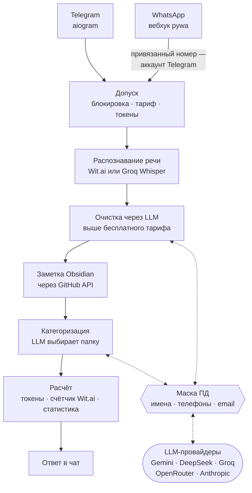

# Evlampiy Notes Bot

[](https://github.com/yastcher/evlampiy/actions/workflows/ci.yml)
[](https://github.com/yastcher/evlampiy/actions/workflows/ci.yml)
[](https://www.python.org/downloads/)
[](../LICENSE)

[English](../README.md) | Русский | [Español](README.es.md) | [Deutsch](README.de.md)

Бот для Telegram и WhatsApp, который переводит голос в текст на четырёх языках: расшифровывает
голосовое сообщение, чистит текст через LLM и сохраняет его заметкой в ваше хранилище Obsidian
на GitHub, в папку по теме.

**Попробовать:** https://t.me/evlampiy_notes_bot

## Как проходит голосовое сообщение



## Возможности

### Основное
- **Транскрипция голоса** — Мгновенное преобразование голосовых сообщений в текст
- **Мультиплатформенность** — Telegram и WhatsApp
- **Мультиязычность** — Английский, немецкий, русский, испанский
- **Настройки по чатам** — Индивидуальный язык и триггер для каждого чата
- **AI-очистка текста** — Опциональная очистка транскрипций через LLM (удаление слов-паразитов, расстановка пунктуации) на тарифах выше бесплатного. При выключенной очистке в `/settings` ответ в Telegram остаётся сырым, но в Obsidian текст всё равно очищается.

### Провайдеры транскрипции
- **Wit.ai** — Провайдер по умолчанию с отслеживанием месячного лимита
- **Groq Whisper** — Фоллбэк при исчерпании лимита Wit.ai; платные пользователи могут выбрать вручную через `/settings`

### Монетизация
- **Система токенов** — 10 бесплатных токенов/месяц + покупные пакеты (1 токен = 20 сек аудио)
- **Telegram Stars** — Нативная интеграция платежей с 4 пакетами
- **Тарифы пользователей** — Free, Paid, VIP (в том числе админы) и Tester; заблокированному бот отказывает

### Интеграция с Obsidian
- **Синхронизация через GitHub** — Автосохранение транскрипций в ваш vault через GitHub API
- **OAuth Device Flow** — Безопасная аутентификация без раскрытия токенов
- **Выбор репозитория** — При подключении можно выбрать существующий репозиторий GitHub или создать новый (с любым именем)
- **Автокатегоризация** — ИИ-классификация заметок (DeepSeek, Groq, Gemini, OpenRouter, Anthropic)
- **Двойное сохранение** — Заметки содержат очищенный текст; исходная транскрипция сохраняется в HTML-комментарии
- **vocabulary.json** — Автоматически пополняемый список ключевых слов по категориям; направляет категоризацию новых заметок
- **Контекст очистки** — Последние транскрипции из этого же чата передаются LLM для более точной очистки

### Привязка аккаунтов
- **Telegram ↔ WhatsApp** — Номер WhatsApp, привязанный одноразовым кодом, становится вашим аккаунтом Telegram: те же токены, настройки и хранилище
- **Rate limiting** — Защита от перебора

### Администрирование
- **Панель администратора** — `/admin` хаб с inline-кнопками в Telegram
- **Управление пользователями** — Добавление/удаление VIP и тестеров, блокировка/разблокировка, пополнение токенов через Telegram
- **Статистика использования** — Транскрипции, доход, расходы за месяц
- **Мониторинг здоровья** — Алерты админам о расходе Wit.ai, первом платеже и вехах дохода

## Инженерные практики

- **Границы держат тесты** — адаптеры Telegram и WhatsApp не импортируют друг друга, а сценарии в `services/` не импортируют aiogram, pywa и FastAPI: иначе падает `tests/test_architecture.py` (pytestarch).
- **Настоящая база в тестах** — MongoDB 8.0.3, тот же образ, что в продакшене, в контейнере testcontainers; моки только на внешних API, а ключей разработчика тесты не видят.
- **Один гейт — двойник CI** — `scripts/gate.sh` запускает то же, что CI, в том же порядке: pip-audit по каждой закреплённой версии, ruff, ty, Semgrep, тесты с порогом покрытия, который только растёт, shellcheck; тест падает, если они разойдутся.
- **Проверки перед релизом** — `scripts/pre_release_qa.sh` добавляет лимит CRAP, смоук стека из релизного образа и мутационное тестирование (mutmut), в котором выживших мутантов становится только меньше; `scripts/release.sh` не тегирует дерево, которое эти проверки не прошло.
- **Релиз — это тег** — CI сверяет тег с деревом, собирает образ и сканирует его Trivy, выкатывает с дампом базы, минутой наблюдения и автоматическим откатом, затем публикует GitHub Release ([конвейер](DEPLOY.md#деплой-на-сервер-cicd)).
- **Персональные данные не попадают в промпты** — имена, телефоны и email заменяются токенами перед любым запросом к LLM и возвращаются в ответе ([ADR-002](adr/ADR-002-pii-is-masked-where-each-llm-client-hands-a-request-to-providers.md)).
- **Решения записаны** — [docs/adr/](adr/README.md) хранит действующие решения с их причинами.

## Требования

- Python 3.14+
- MongoDB
- FFmpeg (для обработки аудио)
- Docker (тесты поднимают MongoDB в контейнере)
- API токены [Wit.ai](https://wit.ai/)
- Токен Telegram бота от [@BotFather](https://t.me/BotFather)
- (Опционально) Данные WhatsApp Business API
- (Опционально) GitHub OAuth App client ID (для интеграции с Obsidian)
- (Опционально) [Groq](https://groq.com/) API ключ (для резервной транскрипции Whisper)
- (Опционально) API ключ ИИ-провайдера — [DeepSeek](https://deepseek.com/), [Groq](https://groq.com/), [Google Gemini](https://ai.google.dev/), [OpenRouter](https://openrouter.ai/) или [Anthropic](https://anthropic.com/) (для автокатегоризации и GPT-команд)

## Быстрый старт

```bash
# Клонирование
git clone https://github.com/yastcher/evlampiy.git
cd evlampiy

# Установка зависимостей
pip install uv
uv sync

# Настройка
cp .env.example .env
# Отредактируйте .env, добавив токены

# Запуск
uv run python -m evlampiy.main
```

## Конфигурация

В `.env.example` перечислены все настройки с комментариями. Минимум:

```env
TELEGRAM_BOT_TOKEN=ваш_токен_бота        # от @BotFather
MONGO_URI=mongodb://localhost:27017/
WIT_RU_TOKEN=ваш_токен_wit               # по одному на каждый язык речи: WIT_EN_TOKEN, WIT_ES_TOKEN, WIT_DE_TOKEN
```

Остальные включают возможности:

- WhatsApp — `WHATSAPP_*`, см. [Настройка WhatsApp](WHATSAPP_SETUP.md)
- хранилище Obsidian — `GITHUB_CLIENT_ID`, см. [GitHub OAuth App](GITHUB_TOKEN_SETUP.md)
- запасной Whisper — `GROQ_API_KEY`
- очистка через LLM, сортировка и GPT-чат — `CATEGORIZATION_PROVIDER` и `GPT_PROVIDER` (по умолчанию Gemini) с ключом этого провайдера; если он не отвечает, цепочка пробует deepseek → openrouter → gemini → groq; хост, которому они недоступны, ходит через `LLM_API_BASE` ([DEPLOY.md](DEPLOY.md#llm-провайдеры-заблокированы-на-хосте))
- админы — `ADMIN_USER_IDS`; VIP-пользователей и тестировщиков назначают через `/admin` в Telegram

## Команды бота

| Команда     | Описание                                 |
|-------------|------------------------------------------|
| `/start`    | Показать справку и текущие настройки     |
| `/settings` | Язык, GPT команда и провайдер            |
| `/obsidian` | Синхронизация заметок с GitHub           |
| `/account`  | Баланс, токены и привязка WhatsApp        |

## Разработка

```bash
# Установка dev-зависимостей
uv sync --group dev

# Запуск тестов
uv run pytest

# Запуск линтера
uv run ruff check

# Проверка типов
uv run ty check evlampiy tests

# Всё, что проверяет CI, в том же порядке (тесты — с порогом покрытия)
scripts/gate.sh
```

## Документация

| Документ | Описание |
|----------|----------|
| [Архитектура](ARCHITECTURE.md) | Структура каталогов, поток данных, инженерные решения, лимиты (English) |
| [Глоссарий](GLOSSARY.md) | Слова проекта: чаты, тарифы, токены, маска, хранилище (English) |
| [Деплой](DEPLOY.md) | Docker, конвейер релиза, дампы базы и откат, health checks, логи |
| [Решения](adr/README.md) | Действующие архитектурные решения, каждое со своей причиной (English) |
| [Администрирование](ADMIN.md) | Команды администратора, роли, алерты, мониторинг |
| [Настройка WhatsApp](WHATSAPP_SETUP.md) | Конфигурация WhatsApp Business API |
| [Привязка аккаунтов](WHATSAPP_LINKING.md) | Привязка Telegram ↔ WhatsApp |
| [GitHub OAuth App](GITHUB_TOKEN_SETUP.md) | OAuth App для `GITHUB_CLIENT_ID`, нужного подключению Obsidian |

## Лицензия

Проприетарная. Все права защищены. См. [LICENSE](../LICENSE).
